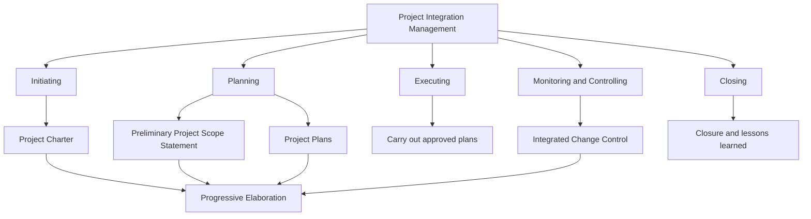

# PF1101A — Chapter 4: Project Integration Management

> [!summary] Chapter overview
> Project Integration Management is the **day-to-day process of ensuring all parts of a project work together**. It connects the other project management knowledge areas across **Initiating, Planning, Executing, Monitoring/Controlling and Closing (IPEMC)**. The lecture focuses especially on the **Project Charter**, **Preliminary Project Scope Statement**, **Project Plans**, **Integrated Change Control**, and **Closing**, with **progressive elaboration** running throughout.

## 4.1 What Project Integration Entails

Project integration is about **pulling the many moving parts of a project together** so that the project can move forward coherently.

- The five PM processes apply across the nine PM knowledge areas.
- Planning, Executing and Monitoring/Controlling are **not strictly sequential**; they may overlap and repeat as conditions change.
- Integration is directly under the **project manager**, even when other knowledge areas are delegated to other people.
- The project manager must ensure important information reaches the relevant stakeholders and is reflected in decisions.
- Integration is not merely combining documents. The important point is that **information, changes and decisions are connected**.

> [!important]
> A project may contain the necessary information and procedures yet still fail if they are not integrated into decision-making.

### Progressive elaboration

At the beginning of a project, much information is incomplete. Plans therefore become more detailed as new information becomes available.

- Early estimates and baselines may be rough.
- Requirements, scope and plans are progressively refined.
- Documents are generally **live documents**, rather than snapshots fixed permanently at the start.
- The extent of allowable change depends on context. In some projects, late changes can be extremely costly.

### Tailoring / adaptation

Project management documents and processes should be adapted to the project context.

- A small project may not require every possible plan or document.
- A sufficiently complex project requires clearer division of responsibilities and stronger integration.
- The lecturer emphasizes contextualizing and simplifying or elaborating templates as appropriate.

## 4.2 Challenger Case Study — Why Integration Matters

The lecture uses the **Space Shuttle Challenger disaster of 28 January 1986** to illustrate failures of integration. Challenger broke apart **73 seconds after lift-off** at about **46,000 ft**, killing all seven crew. The stated cause was failure of the primary and secondary O-ring seals in a field joint of the right solid rocket booster.

### One system, many interfaces

The shuttle was an integrated system containing the orbiter, external tank, solid rocket boosters and field-joint O-rings. A small component could therefore govern the safety of the whole system.

![[Attachments/Challenger Integrated System.png]]

### Information existed before the launch

Evidence of O-ring problems had accumulated for years, and a redesign was already underway. A record-low temperature was forecast for the launch. The issue was therefore not simply a lack of information; the missing element was a process that forced the information into the launch decision.

![[Attachments/Challenger Five Years of Signals.png]]

### The night before the launch

Morton Thiokol engineers argued that cold could stiffen the rubber and prevent the seals from seating in time. A recommendation was made **not to launch below 12 °C (53 °F)**. After an off-line management caucus, the recommendation was reversed and a launch recommendation was submitted. The O-ring concern did not reach the NASA Mission Management Team leader.

The lecturer highlights that booster temperature was not part of the launch commit criteria. Without a predetermined decision rule, pressure could influence the decision.

### Where integration management should have intervened

![[Attachments/Integration Intervention Across IPMC.png]]

Across IPEMC, the lecture identifies several opportunities:

1. **Initiating** — governance should state safety as a non-negotiable objective and identify who has stop authority.
2. **Planning** — launch criteria should define acceptable temperature ranges, risk thresholds and escalation routes.
3. **Executing** — critical concerns should reach the person with decision authority.
4. **Monitoring & Controlling** — flight history, test results, forecasts and engineering judgement should be brought together.
5. **Integrated Change Control** — launching under an unprecedented colder condition should be treated as a formal deviation and assessed before approval.
6. **Closing & Learning** — lessons should be captured and incorporated so later projects inherit them.

### Three lessons from Challenger

![[Attachments/Three Integration Lessons.png]]

> [!important]
> **Information is not integration.** A fact being known somewhere in the organisation is not the same as that fact reaching the person who decides.

> [!important]
> **Set the rules before the pressure.** Criteria, thresholds and authority should be defined before a crisis occurs.

> [!important]
> **An unprecedented condition is a change.** Conditions outside previous experience should enter integrated change control rather than be treated as routine.

## 4.3 Developing the Project Charter — Initiating

The **Project Charter** is an agreement used to secure stakeholder agreement and to **grant power to the project manager to use resources**. It establishes the starting point for the project even though not all details are known yet.

### What the Project Charter communicates

![[Attachments/Project Charter Contents.png]]

The lecture lists:

1. Project requirements
2. Big picture
3. Project purpose
4. Milestone schedule
5. Stakeholder influences
6. Functional organizations
7. Assumptions
8. Constraints
9. Summary budget
10. Procurement/contracts

The charter may also identify the **project sponsor/champion**, **process owner/team leader**, and **project manager/leader**, together with approvals.

> [!important]
> A key purpose of the Project Charter is to **formally authorize the project manager** to work on the project and use organizational resources.

### Functional organization vs project organization

The lecturer distinguishes the organization running the project from the project team itself.

- Functional organizations may include HR, engineering, marketing and other departments.
- The project manager need not be the CEO.
- A CEO may have multiple project managers responsible for different projects.
- The project organization chart and the organizational chart therefore serve different purposes.

### Project Charter and progressive elaboration

At the start, the charter may contain only broad information. Once the project manager and team begin working with stakeholders, later documents can elaborate the project in more detail. The charter may also be updated as information becomes clearer.

> [!warning]
> **Project Charter ≠ Preliminary Project Scope Statement.** The charter is the starting authorization for the project and project manager. The scope statement later describes the project scope in greater detail.

## 4.4 Developing the Preliminary Project Scope Statement

The **Preliminary Project Scope Statement** defines what the project is to **accomplish, create and deliver**. It gives stakeholders a common understanding of the project's purpose and reflects stakeholder expectations as planning develops.

The lecturer emphasizes that the scope should be understood before jumping directly into schedules, costs and execution.

### What the scope statement documents

![[Attachments/Preliminary Project Scope Statement Contents.png]]

1. Project objectives
2. Project deliverable characteristics
3. Acceptance criteria
4. Project boundaries
5. Constraints and assumptions
6. Initial project risks
7. Milestones
8. Initial Work Breakdown Structure (WBS)
9. Rough cost estimates
10. Management requirements
11. Approval requirements

### Project boundaries

Project boundaries make clear **what is in and what is out** of the project. This prevents work from drifting into areas that are unnecessary or outside the intended project.

### Acceptance criteria

Acceptance criteria describe what is considered acceptable for the project and are related to the later quality goals.

### Charter vs scope statement

There can be repetition between the two documents because of progressive elaboration.

- The **Project Charter** comes first and authorizes the project/project manager based on the information available.
- The **Preliminary Project Scope Statement** is developed later by the project manager, project team and stakeholders and provides more detailed scope information.
- Information refined in the scope statement may lead to updates to the charter.

> [!important]
> The lecturer states that **WBS comes after the scope statement**. The scope must first define what the project is intended to accomplish and deliver.

## 4.5 Developing the Project Plans — Planning

Project plans guide how the project should flow and be managed. They communicate how the project will be managed and controlled, and provide:

1. **Structure**
2. **Documentation**
3. **Communication**
4. **Baselines**

The project manager and project management team develop these plans progressively.

### Logical development of the plans

![[Attachments/Project Plan Development Process.png]]

The lecture presents planning as a logical, systematic progression from broader requirements toward detailed plans. It moves through business requirements, functional requirements, technical requirements, design plans and WBS toward scheduling and final planning. Planning may iterate when new items or changes are discovered.

> [!important]
> **Design follows functions.** The required function is established before the design is developed to satisfy it.

### The “bunch of plans”

The lecture lists the following project plans/items:

- Project Scope Management Plan
- Time (Schedule) Management Plan
- Cost Management Plan
- Quality Management Plan
- Process Improvement Plan
- Staffing Management (HR) Plan
- Communications Management Plan
- Risk Register
- Risk Management Plan
- Procurement Management Plan
- Milestones List
- Resource Calendar
- Project Baselines
- Open Issues

These plans are **interrelated**, not independent. For example:

- time and cost are linked through activity duration and resource use;
- quality controls can require additional time;
- human resources affect cost and schedule;
- procurement and resource availability affect execution.

### Responsibility and accountability

Not everyone should be responsible for everything. Different team members can be assigned responsibility for different plans, while the project manager integrates them and maintains the overall project direction.

## 4.6 Executing the Project Plan

Execution is where the project plans become actual work.

The lecture identifies the following execution activities:

1. Do the work.
2. Spend the funds.
3. Manage, train and lead the project team.
4. Acquire, manage and use resources.
5. Complete procurement requirements.
6. Manage risks.
7. Implement approved changes in the project.
8. Manage communications.
9. Collect data for performance reporting.
10. Complete lessons learned documents.

Other considerations include:

- applying **corrective actions**;
- considering **preventive actions**;
- managing **change requests**;
- managing **defect repairs**.

> [!important]
> Risk management continues during execution. The project manager should know and continually watch the project's top risks.

### Corrective vs preventive actions

- **Preventive actions** are considered before an issue occurs.
- When a risk becomes an issue, **corrective actions** may be needed.
- Lessons learned should be captured along the way rather than only at the final project close.

## 4.7 Monitoring & Controlling the Project Work

Monitoring and controlling compares actual project work against what was planned and identifies where action may be required.

### Tools and approaches

The lecture highlights:

- **Project Management Information System (PMIS)** — supports and automates project management procedures and reporting;
- **Earned Value Management (EVM)** — used for monitoring and forecasting;
- **expert judgement** — needed to interpret performance in context.

A PMIS can collect updates from project participants, support performance reporting and help reveal gaps between planned and completed work.

### Possible outcomes of monitoring/control

Examining project results may lead to:

- recommending corrective actions;
- recommending preventive actions;
- forecasts such as EVM;
- recommending defect repairs;
- requesting changes;
- termination.

Termination may be appropriate when continuing no longer provides sufficient future value; the lecturer links this to avoiding the **sunk cost fallacy**.

## 4.8 Integrated Change Control

Change is common in projects. Changes may arise from weather, legislation, suppliers, technical conditions, software, design decisions or other environmental factors.

A change can affect multiple areas at once, including **scope, approvals, cost, schedule, quality and stakeholders**. It therefore needs structured assessment rather than an ad-hoc decision.

### Integrated change control process

All change requests or variations should be routed through integrated change control.

![[Attachments/Integrated Change Control Flow.png]]

A basic process described in the lecture is:

1. A **proposed change** is raised.
2. The change is documented in the project management/change control system.
3. A **Change Control Board** or appropriate decision-makers assess the change.
4. Consider the **value of the change**, benefits/costs, risks and other implications.
5. Decide whether the change is approved.
6. If approved, update the relevant project plans and baselines.
7. If not approved, inform the relevant stakeholder and archive the decision.
8. Communicate the outcome so affected stakeholders know what is happening.

### Decision authority and thresholds

Not every change needs the same decision-makers.

- A small-cost change may be approved at a lower level.
- A major change with substantial cost or risk may require senior managers.
- The required expertise also matters; the people assessing the change should be relevant to the issue.
- The **power and authority should match the cost or risk implication**.

### GRPP change control

The lecturer expects the GRPP to contain a **more comprehensive flow chart** showing how changes are raised, documented, assessed, approved/rejected and communicated.

![[Attachments/GRPP Integrated Change Control Example.png]]

> [!important]
> Before implementing a change, **assess its impact and submit it for formal approval**.

## 4.9 Closing the Project

For projects with multiple phases, closing occurs at the **end of each phase**, not only once at the end of the entire project.

### Administrative closure

![[Attachments/Project Administrative Closure.png]]

Administrative closure includes:

1. Collect and assemble project records.
2. Analyze project success or failure.
3. Gather lessons learned documents.
4. Archive project information.

The purpose is to preserve useful project artifacts so future projects can refer to previous durations, costs, issues and lessons.

### Contract closure

Contract closure with a customer or vendor includes:

1. Administrative closure
2. Product verification
3. Early contract termination conditions
4. Payment terms
5. Formal acceptance documents
6. Project files
7. Project closure documents
8. Historical information

Proper closure matters because incomplete contract and acceptance documentation can lead to disputes and legal implications.

## 4.10 Application to the GRPP

For **Integration Management**, the lecturer repeatedly emphasizes three core GRPP components:

1. **Project Charter** — identify the client, project sponsor and top-management approval that gives the project the go-ahead.
2. **Preliminary Project Scope Statement** — describe what the project team understands the client needs and obtain agreement/sign-off.
3. **Integrated Change Control System** — define how changes to scope and other project aspects are assessed, approved and communicated.

These are connected through **progressive elaboration**: as the project becomes clearer, information is refined and controlled changes are incorporated.

The lecturer also encourages teams to develop a **team charter**, separate from the Project Charter, to establish expectations such as meeting frequency, communication platforms and how differences in opinion will be resolved.

## Chapter 4 — Key Connections

- **Project Charter** establishes authority and the initial project direction.
- **Preliminary Project Scope Statement** elaborates what the project will accomplish and its boundaries.
- **Project Plans** translate the project into coordinated management plans and baselines.
- **Execution** turns plans into action.
- **Monitoring & Controlling** compares actual work with the plan and identifies needed action.
- **Integrated Change Control** assesses and coordinates changes across the project.
- **Closing** formally completes phases/project work and captures information for future use.
- **Progressive elaboration** connects the stages as information becomes clearer over time.

> [!summary] Core lecture message
> Project Integration Management is the knowledge area that **holds the other areas together**. The project manager must act as a systems thinker: pulling information, people, plans, changes and decisions together so that the whole project functions as one system.

## Exam / Revision Checklist

- [ ] Can I explain what Project Integration Management entails?
- [ ] Can I explain why IPEMC processes can overlap and iterate?
- [ ] Can I explain **progressive elaboration**?
- [ ] Can I explain the Challenger case as an integration-management failure?
- [ ] Can I state the three integration lessons from the Challenger case?
- [ ] Can I explain the purpose of a **Project Charter**?
- [ ] Can I list the major information contained in a Project Charter?
- [ ] Can I distinguish the **Project Charter** from the **Preliminary Project Scope Statement**?
- [ ] Can I explain what a Preliminary Project Scope Statement defines and documents?
- [ ] Can I explain why project boundaries and acceptance criteria matter?
- [ ] Can I explain how project plans are developed and why they are interrelated?
- [ ] Can I describe the main activities involved in executing the project plan?
- [ ] Can I distinguish preventive actions from corrective actions as presented in the lecture?
- [ ] Can I explain the role of PMIS, EVM and expert judgement in Monitoring & Controlling?
- [ ] Can I identify possible outcomes of Monitoring & Controlling?
- [ ] Can I describe a structured **Integrated Change Control** process?
- [ ] Can I explain why approval authority should depend on cost, risk and expertise?
- [ ] Can I describe administrative closure and contract closure?
- [ ] Can I identify the three main Integration Management items required in the GRPP?

## Key Concepts / Frameworks

| Concept | Lecture meaning / role |
|---|---|
| **Project Integration Management** | Day-to-day processes ensuring all parts of the project work together. |
| **IPEMC** | Initiating, Planning, Executing, Monitoring/Controlling and Closing; processes can overlap and repeat. |
| **Progressive elaboration** | Plans and project information become more detailed as more information becomes available. |
| **Project Charter** | Starting agreement that secures stakeholder agreement and grants authority/resources to the project manager. |
| **Preliminary Project Scope Statement** | Defines what the project will accomplish, create and deliver, including boundaries and acceptance criteria. |
| **Project Plans** | Interrelated plans that provide structure, documentation, communication and baselines. |
| **Monitoring & Controlling** | Examines project performance and can lead to corrective/preventive action, forecasts, repairs, change requests or termination. |
| **Integrated Change Control** | Structured process for raising, assessing, approving/rejecting, documenting and communicating changes. |
| **Closing** | Formal completion of phases/project work, including records, acceptance, lessons learned and archival. |
