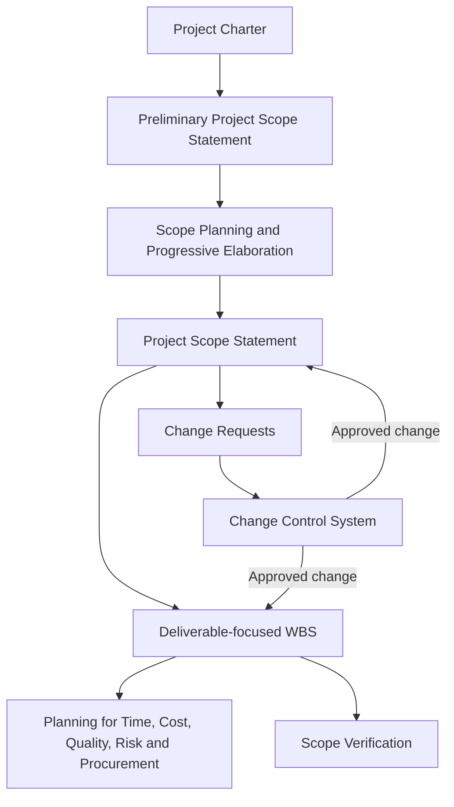

# PF1101A — Chapter 5: Project Scope Management

> [!summary] Chapter overview
> Project scope management ensures that a project includes **all of the work required, and only the work required**, to complete the project successfully. The lecture develops scope management through three broad parts: **establishing scope**, **managing scope change**, and **verifying scope**. It covers project versus product scope, progressive elaboration, the scope management plan, scope definition and scope statements, the Work Breakdown Structure (WBS), scope verification, scope creep and gold plating, change requests, and the change control system.

## 5.1 Why Project Scope Management Matters

A project can be delivered on time, within budget, and with good workmanship, yet still fail if the client says: **“This is not what I asked for.”** The central purpose of scope management is therefore to clarify exactly what the client or customer wants and needs before and during project delivery.

The lecturer emphasized that scope management is closely connected to other project management knowledge areas. Scope decisions affect cost, time, quality, risk, communications, procurement, and other plans. Changes must therefore be considered through **integrated change control**, rather than treated in isolation.

For the GRPP, the team should clearly establish:

- who the team is representing;
- what role that party plays in the industry ecosystem;
- who the client/customer is;
- why that party is in a position to push the proposed project or solution;
- what the project is intended to deliver.

This clarity helps establish the preliminary project scope and prevents confusion over what the project team is actually responsible for.

### Progressive elaboration and scope

At the initiating stage, the project begins with a **preliminary project scope statement**. As more information becomes available, the scope is progressively elaborated into a more detailed and usable definition.

> [!important]
> Scope is **not a snapshot in time**. It becomes more detailed as assumptions are tested, constraints become clearer, stakeholders provide input, and approved changes occur.

The lecture groups Topic 5 into three major parts:

1. **Establishing Scope**
2. **Managing Scope Change**
3. **Verifying Scope**

---

## 5.2 Piper Alpha Case Study — Scope Decisions Can Create Long-Term Risk

The Piper Alpha case demonstrates that poor project scope decisions may not create an immediate project failure. Their consequences can remain hidden until later operations.

![[Attachments/Piper Alpha - Three Projects One Night.png]]

### Three projects that set the conditions

Piper Alpha was an offshore oil and gas platform in the North Sea operated by Occidental Petroleum. On 6–7 July 1988, an explosion and collapse killed 165 of the 226 people on board, plus two rescuers; 61 survived.

Although the accident occurred during **operations**, earlier projects shaped the conditions:

- **1975–76:** the platform was designed and built as an oil-only platform;
- **1978:** it was converted to add gas production;
- **1988:** a major revamp involving six sub-projects was underway.

The lecturer's project management point was that the accident itself was operational, but important hazards had been created or left unresolved by earlier **scope decisions**.

### 1978 — a scope change not fully assessed

![[Attachments/Piper Alpha - 1978 Scope Change.png]]

The original oil-only platform was arranged so that the most hazardous operations were separated from personnel areas. In 1978, a gas conservation module was added to meet government gas-conservation requirements and avoid flaring.

This change broke the original layout principle:

- gas compression ended up next to the control room;
- the platform had originally been designed for oil;
- its firewalls resisted fire but were not designed to resist explosions.

> [!important]
> **Management of change:** a scope change must be assessed not only for what it adds, but also for what it removes, weakens, or makes more vulnerable.

### 1988 — producing through the revamp

![[Attachments/Piper Alpha - 1988 Revamp Scope Decision.png]]

During the 1988 major revamp, Occidental chose to keep the platform producing rather than shut down as originally planned.

The lecture treats this as a decision involving **scope boundary, constraints, and assumptions**. Continuing full production during major project work created its own risk profile.

> [!warning]
> An assumption is not the same as verification. Assumptions should be recorded, tested, and tied to clear responsibility.

### What changed after Piper Alpha

![[Attachments/Piper Alpha - Scope Lessons.png]]

Following the accident, additional analyses became standard design deliverables, including:

- fire and explosion risk analysis;
- temporary refuge impairment analysis;
- escape, evacuation and rescue analysis;
- emergency systems survivability analysis.

These are **scope items** because they can appear in the scope statement, WBS, and acceptance criteria.

The key lesson is that defining what counts as a **complete** project matters. If an important analysis or deliverable is omitted from scope, the consequences may only become visible later during operations.

---

## 5.3 What Is Project Scope?

> [!definition]
> Project scope management consists of the processes that ensure the project includes **all of the work required, and only the work required, to complete the project successfully**.

Projects require focus and concentration. The goal is to perform the work that is actually required — **no more and no less**.

A **project scope statement** describes:

- what work is required;
- what work **will** be included;
- what work **will not** be included.

Defining scope can take substantial effort because clients may initially have only a broad idea of what they need. The scope-definition process itself helps the client and project team clarify those needs.

### Scope creep

**Scope creep** occurs when the project begins with an initial scope but additional items keep being added, causing the scope to grow progressively.

This can make it difficult to complete the project within the original resources, schedule, and budget.

---

## 5.4 Purposes of Project Scope Management

Project scope management provides a basis for deciding what belongs in the project and what does not.

Its purposes are to:

- define the work needed to complete the project objectives;
- guide the determination of work that is **not** needed;
- determine what work is included in the project;
- provide a reference for what work is excluded.

A clearly defined scope also supports later cost and schedule planning. If the scope is vague, cost estimates will also be rough and unreliable.

---

## 5.5 Project Scope versus Product Scope

![[Attachments/Project Scope versus Product Scope.png]]

### Product scope

**Product scope** describes the characteristics and features of the product created by the project.

The lecturer distinguished between **requirements** and **specifications**:

- **Requirements** are generally expressed from the user's point of view and describe functions or features in a broader sense.
- **Specifications** are more specific and may translate a requirement into a clear quantitative target.

Example from the lecture:

- Requirement: a phone should be usable day in and day out with minimal charging.
- Specification: the battery must operate in a specified mode for at least a stated number of hours.

Product scope is measured against **requirements/specifications**.

### Project scope

**Project scope** sets out the work required to create the deliverables and may include more than the final product itself. It can include intermediate deliverables, approvals, legal requirements, and other work needed to achieve the final product.

Project scope is measured against the **project scope management plan**.

> [!important]
> Project scope and product scope are closely connected, but they are not identical. Product scope focuses on the final product's features; project scope covers the work and intermediate deliverables required to produce it.

---

## 5.6 Planning the Project Scope

Scope planning involves **progressive elaboration**:

1. begin with a broad understanding of the project;
2. refine the understanding as more information becomes available;
3. become increasingly focused on the work that is actually required.

The two main goals of scope planning are:

1. create the **project scope statement**;
2. create the **project scope management plan** describing how scope will be managed, changed, verified, and accepted.

### Planning tools

Two tools highlighted in the lecture are:

- **Expert judgement** — consult experts, users, people who have used similar products, and people familiar with the relevant domain.
- **Organizational templates, forms, and standards** — use existing internal standards, Singapore Standards, international standards, procedures, and similar references where relevant.

These references help avoid defining every requirement from scratch.

### Scope Management Plan

The scope management plan explains how scope is managed and how changes are factored into the project. The lecturer compared it to an **SOP (Standard Operating Procedure)**.

It may also define the expected likelihood, frequency, and magnitude of scope changes. A mature, familiar project may have relatively stable scope, while an innovative project may experience frequent changes.

![[Attachments/Scope Management Plan SOPs.png]]

The scope management plan defines four main procedures:

1. SOP to create a detailed project scope statement;
2. SOP to create the WBS;
3. SOP for the customer to formally accept deliverables;
4. SOP to evaluate, approve, or decline changes.

The last procedure is closely connected to **integrated change control**.

---

## 5.7 Creating the Project Scope Definition

Scope definition breaks the work into more manageable parts and develops a detailed route from the project's broad idea to the required outcome.

A logical process may include stages such as:

- design;
- plan;
- fabricate;
- install.

The exact structure depends on the project.

### Inputs to scope definition

The lecture identifies the following inputs:

- organizational assets such as guidelines and procedures;
- Project Charter;
- Preliminary Project Scope Statement;
- Project Scope Management Plan;
- approved change requests.

These inputs mean that scope definition does **not** begin from scratch.

### Product analysis

Product analysis helps the team understand the product through approaches including:

- product breakdown;
- systems engineering;
- value engineering;
- value analysis;
- function analysis;
- Quality Function Deployment.

The lecturer explained several of these ideas:

- **Product breakdown** separates the product into sub-components.
- **Systems engineering** considers the product as a whole and the interactions between its components.
- **Value engineering** asks how cost can be minimized while value is maximized.
- **Value analysis** focuses on the value being delivered.
- **Function analysis** considers what functions the product performs and whether stakeholder expectations are met.
- **Quality Function Deployment** helps translate customer needs into technical requirements.

### Alternatives, stakeholders, and updates

Other activities during scope definition include:

- finding alternatives and progressively elaborating them;
- performing stakeholder analysis;
- updating scope when necessary;
- notifying stakeholders of changes and their justifications.

For the GRPP, the lecturer advised keeping alternatives available during the earlier tutorial stages. Feedback may reveal that an initial idea should be changed or replaced before the project charter becomes more established.

---

## 5.8 Examining the Scope Statement

The **scope statement** is an output of scope planning and guides future project decisions. It is not literally a single sentence; for complex projects it can consist of a substantial set of documents.

![[Attachments/Scope Statement Items 1 to 12.png]]

The lecture lists the following possible components:

1. Project objectives
2. Product scope description
3. Project requirements
4. Project boundaries
5. Project deliverables
6. Project acceptance criteria
7. Project constraints
8. Project assumptions
9. Initial project organization
10. Initial defined risks
11. Scheduled milestones
12. Fund limits

![[Attachments/Scope Statement Items 13 to 16.png]]

The list continues with:

13. Cost estimates
14. Project configuration management — identifies the level of change control and supports version management
15. Project specifications
16. Project approval requirements

### Tailoring the scope statement

> [!important]
> The 16-item list is a standard reference, not a requirement that every project must contain every item separately.

The lecturer emphasized **adaptation/tailoring**:

- some items may be merged when they overlap;
- some may be unnecessary for a small project;
- some may be covered more clearly in another management plan;
- acceptance criteria are generally more specific than requirements because they identify how compliance will be tested or measured.

The most important role of the scope statement is to define **what is in and what is out** and thereby avoid misunderstanding.

### Configuration management

Configuration management is concerned with **versioning/version control**.

Examples include:

- different versions of construction drawings after changes;
- different software versions documenting what was added, removed, or modified.

### Cost estimates and specifications

The lecture used built-environment examples to show how scope supports estimating:

- approximate building-cost references can support early estimates;
- specifications describe work in enough detail for those carrying out or bidding for the work to understand what is required.

> [!important]
> If scope is unclear, cost estimates become unreliable. Scope therefore forms a foundation for later cost management.

In the built environment, the complete scope may be represented through stacks of drawings, Bills of Quantities, specifications, architectural models, and digital BIM models.

---

## 5.9 Creating the Work Breakdown Structure (WBS)

The lecturer calls the **Work Breakdown Structure (WBS)** the **“Mothership”** because it provides input to many other project management processes.

The WBS:

- identifies all project components;
- is a collection of project components;
- becomes more detailed at each level;
- breaks down the deliverables;
- helps identify relationships between work packages;
- provides input to other project management processes.

### WBS Dictionary

A **WBS Dictionary** can provide additional information associated with WBS items, including:

- resources;
- time;
- cost estimates;
- other supporting details.

### Work package

The **work package** is the smallest component in the WBS.

The lecture gives a rough recommendation that a work package should be:

- no smaller than **8 hours**;
- no larger than **80 hours**.

> [!warning]
> The lecturer explicitly described the 8–80 hour range as a **rough guide**, not a rigid rule. Work packages can be structured differently depending on the project.

### Why the WBS is the “Mothership”

The WBS provides input to processes such as:

- Project Management Plan;
- defining project activities;
- estimating project cost;
- determining the project budget;
- planning project quality;
- identifying project risks;
- planning project procurement.

This is why the WBS forms an important interface between scope management and later knowledge areas such as time and cost management.

### Deliverable-oriented WBS

![[Attachments/Deliverable Oriented WBS Example.png]]

For the GRPP, the lecturer strongly emphasized making the WBS **deliverable-focused** rather than activity-focused.

For example:

- use **Project Charter**, not “initiate project”;
- use **VR Software Module**, not “create VR software”;
- identify the tangible product or output rather than the action used to create it.

![[Attachments/WBS Deliverable Focus Rules.png]]

#### Rules for a deliverable-focused WBS

1. Use **noun-based deliverable names**.
2. Include **tangible outputs**, not resources or activities.
3. Apply the **100% rule** with mutually exclusive branches.
4. Decompose the project into manageable work packages for planning and control.
5. Exclude schedule logic and execution steps.

The **100% rule** means the WBS should describe the complete set of deliverables, while mutually exclusive branches avoid placing the same item in more than one branch.

### Common WBS problems shown in the lecture

The lecturer examined a poor WBS and identified problems such as:

- phase/activity focus instead of deliverable focus;
- verb/action-based items;
- mixing deliverables with activities, decisions, resources, and stakeholders;
- non-tangible items such as liaison, feedback, workforce, and cost summary;
- inconsistent decomposition;
- unclear parent-child relationships;
- failure to clearly follow the 100% rule and mutually exclusive deliverables.

> [!example]
> In the campus wayfinding app poll, **interactive prototype** was considered a clearer WBS deliverable than “design screens,” “meet users,” or “assign programmers.” The latter choices are either vague or activity/resource focused.

---

## 5.10 Verifying the Project Scope

Scope verification occurs during monitoring/controlling and towards closing. The project team should not wait until final handover to discover whether the scope has been met.

![[Attachments/Project Scope Verification.png]]

### Scope verification process

1. The customer accepts project deliverables.
2. Verification happens at the end of each phase or when major deliverables are created.
3. Scope verification and **Quality Control** happen together.
4. Inspect work results and compare them with project plans for completeness, while QC checks correctness.
5. Compare against plans, specifications, drawings, blueprints, and other relevant references.
6. QC inspection may measure, examine, and test the product.
7. Conduct joint inspection between the PM/project team and the client or representatives.
8. Joint inspection may include product reviews, audits, and walkthroughs.
9. Once verified, the customer formally accepts the deliverables.
10. Verification may produce conditional outcomes such as cancellation, failure, corrective action, or putting the project on hold.
11. If the agreed scope/product has been fulfilled, the project can be complete even if the customer remains unhappy.

The lecturer noted that the aim is still to satisfy the client, but the agreed scope must provide a fair basis for deciding when the project is complete.

---

## 5.11 Protecting the Project Scope from Change

The project scope should be protected from **unnecessary** changes. In the built environment, changes are also commonly called **variations**.

### Scope creep and gold plating

- **Scope creep:** additional scope components keep being added after the scope has been defined.
- **Gold plating:** the project team itself adds unnecessary features or improvements beyond the agreed scope, even though the client did not request them.

Example: adding unnecessary “bells and whistles” to a website beyond what the client asked for.

![[Attachments/Protecting Scope from Change.png]]

A reliable change system should:

1. track, monitor, manage, and review changes;
2. determine whether changes are agreed, whether change has already happened, and how to manage it when it happens;
3. accept that change requests can come from many different parties;
4. recognize that performance reports may generate change requests;
5. require supporting documents describing impacts on scope, re-planning, schedule, budget, etc.;
6. reference the WBS to identify affected work packages.

> [!important]
> The WBS remains the reference point for determining which parts of the project are affected by a proposed change.

### NoMa condominium example

The lecture used the NoMa condominium as an example of a major external constraint requiring scope change. The developer intended to acquire seven terraced houses but secured only five. Two owners refused to sell, so the design had to change substantially around the remaining properties.

The case illustrates that scope changes may arise because the assumptions or conditions under which the original project was planned do not materialize.

---

## 5.12 Considering Change Requests

A change request may involve:

- additional work;
- adjustments;
- reduction in scope.

Change requests can be:

- oral or written;
- direct or indirect;
- internal or external;
- legally mandated or optional.

The lecturer stated a preference for important changes to be **written**, especially for major scope changes, so that the request is clear and documented.

### Why change requests happen

Change requests may result from:

- **value-add**;
- **external events**;
- **errors/omissions**;
- **response to a risk**.

Changes are not automatically bad. Some changes are necessary to improve the project, correct omissions, respond to external requirements, or create better stakeholder value.

---

## 5.13 Change Control System

The scope change control system closely follows the ideas of **Integrated Change Control** covered previously.

![[Attachments/Change Control System.png]]

The lecture identifies the following considerations:

1. Preferably use a computerized and automated system.
2. Catalogue change requests and associated paperwork.
3. Track requests.
4. Determine approval levels.
5. Use Integrated Change Control to inform all affected stakeholders.
6. Map the change to the contract if a vendor is involved.
7. After approval, trigger additional iterative planning.
8. Update the WBS/scope to reflect the change.
9. Use corrective actions if the request was caused by nonconformance.
10. Update lessons learned.
11. Update project baselines, including time, cost, scope, etc.

### Approval levels

The lecturer emphasized that different changes may require different approval levels. A small-value change and a very large-value change should not necessarily be approved by the same people.

For the GRPP integrated change control flow chart, the team should therefore consider:

- approval thresholds;
- who can approve which level of change;
- how affected stakeholders are informed;
- how approved changes trigger updates to related project plans.

### Effects of an approved scope change

An approved scope change may require the team to revisit:

- cost;
- time/schedule;
- WBS;
- scope baseline;
- contracts/procurement;
- corrective actions;
- lessons learned.

The lecturer highlighted **schedule, cost, and scope** as especially important baselines that may need updating.

---

## 5.14 Scope Documents Across Industries

Different industries may use different terminology for documents that perform a similar scope-defining function.

For example, the final scope may appear as:

- a project scope statement;
- a project brief;
- part of a contract;
- another industry-specific document.

The lecture used the RIBA project brief as a built-environment example. The key idea is not the document name, but whether it clearly defines the project and the information required to guide later work.

---

## Chapter Summary / Key Connections

![[Attachments/Project Scope Management Summary.png]]

The lecture can be summarized as a five-part flow:

1. **Define** — agree what is in and out; translate objectives into deliverables, boundaries, requirements, assumptions, constraints, and acceptance criteria.
2. **Decompose** — build a deliverable-focused WBS and apply the 100% rule with mutually exclusive branches.
3. **Plan** — use scope as the planning foundation for schedule, cost, resources, quality, risk, and procurement.
4. **Verify** — obtain formal acceptance by checking completeness against the agreed scope and correctness through quality control.
5. **Control change** — assess changes before approval, update the WBS/scope and related plans, and communicate deliberately.

> [!summary]
> **Scope is the project's promise:** define the right work, make it visible, and change it deliberately.

The overall relationship developed in the lecture is:

---

## Exam / Revision Checklist

- [ ] Can I explain why a project may still fail even if it is on time, within budget, and technically well executed?
- [ ] Can I state the purpose of project scope management?
- [ ] Can I explain the three major parts: establishing scope, managing scope change, and verifying scope?
- [ ] Can I explain progressive elaboration in relation to scope?
- [ ] Can I distinguish **project scope** from **product scope**?
- [ ] Can I distinguish a broad **requirement** from a more specific **specification** using the lecture's logic?
- [ ] Can I identify the two scope-planning tools highlighted in the lecture?
- [ ] Can I explain the four SOPs in the Scope Management Plan?
- [ ] Can I identify the inputs to scope definition?
- [ ] Can I list the product-analysis approaches introduced in the lecture?
- [ ] Can I explain why stakeholder analysis and alternatives matter during scope definition?
- [ ] Can I identify the main items that may appear in a project scope statement?
- [ ] Can I explain why scope statements must be tailored to the project context?
- [ ] Can I explain configuration management as version management?
- [ ] Can I explain why unclear scope produces weak cost estimates?
- [ ] Can I explain why the WBS is called the **Mothership**?
- [ ] Can I define a work package and recall the lecturer's rough 8–80 hour guideline?
- [ ] Can I explain the role of the WBS Dictionary?
- [ ] Can I construct a **deliverable-focused** rather than activity-focused WBS?
- [ ] Can I apply noun-based deliverable naming and the **100% rule**?
- [ ] Can I identify the problems in an activity-focused WBS?
- [ ] Can I describe the scope-verification process and its relationship with Quality Control?
- [ ] Can I distinguish **scope creep** from **gold plating**?
- [ ] Can I explain why change requests may be necessary rather than automatically harmful?
- [ ] Can I identify the forms and causes of change requests?
- [ ] Can I explain the main components of a change control system?
- [ ] Can I explain why approval thresholds and stakeholder communication matter in Integrated Change Control?
- [ ] Can I explain the project-management lessons from Piper Alpha?

---

## Key Concepts / Frameworks

| Concept | Core lecture meaning |
| --- | --- |
| **Project Scope Management** | Ensures all required work, and only required work, is included. |
| **Project Scope Statement** | Defines required work and what is in/out of the project. |
| **Product Scope** | Characteristics and features of the final product. |
| **Project Scope** | Work and deliverables required to create the product and complete the project. |
| **Progressive Elaboration** | Scope and project documents become more detailed as information becomes available. |
| **Scope Management Plan** | SOP-like plan describing how scope is defined, WBS is created, deliverables are accepted, and changes are evaluated. |
| **WBS** | Deliverable breakdown identifying project components; the lecture's “Mothership.” |
| **WBS Dictionary** | Supporting information for WBS items such as resources, time, and cost estimates. |
| **Work Package** | Smallest WBS component; 8–80 hours was given as a rough guideline. |
| **100% Rule** | WBS should cover the complete deliverable scope with mutually exclusive branches. |
| **Scope Verification** | Inspection and formal acceptance of deliverables against the agreed scope. |
| **Scope Creep** | Uncontrolled growth of scope through added components. |
| **Gold Plating** | Project team adds unnecessary work/features beyond the agreed scope. |
| **Change Request** | Proposed additional work, adjustment, or reduction in scope. |
| **Change Control System** | Structured process to catalogue, track, assess, approve/reject, communicate, and implement changes. |
| **Configuration Management** | Version management for controlled project documents/products. |

> [!important] Final lecture message
> There is little value in executing work efficiently if it is work that should not have been done in the first place. Scope management provides the foundation for ensuring the project team is working on the **right work**.
