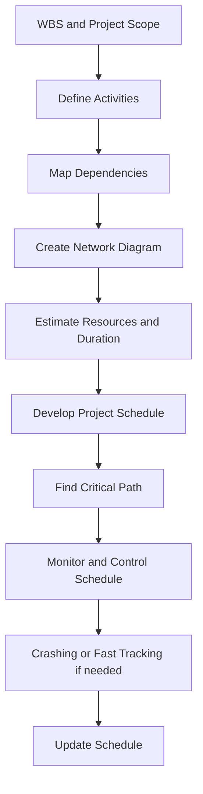

# PF1101A — Chapter 6: Project Time Management

> [!summary] Chapter overview
> Project Time Management, also described in the lecture as **Project Schedule Management**, is predominantly about planning how project work will be carried out over time. The schedule is not merely a list of dates: it translates the project scope into **activities, durations, dependencies, resource requirements, constraints and controls**. The chapter develops this from defining activities through mapping and network diagrams, estimating durations, developing the schedule, identifying the critical path, and finally compressing, controlling and updating the schedule.

## 6.0 Why Project Time Management Matters

The lecturer emphasized that time itself cannot really be changed; what the project team can manage is the **schedule**.

Project time management is closely integrated with the other project management knowledge areas:

- **Scope** provides the work that must be delivered.
- **Resources** determine what can be done and how quickly.
- **Cost** is affected by the amount of time and resources used.
- **Risk** affects activity duration and sequencing.
- **Procurement** affects when external resources become available.
- **Quality** must be checked when activities or deliverables are completed.
- **Communication** is needed to coordinate upcoming activities and stakeholders.

![[Attachments/Time Management Integration.png]]

> [!important]
> The lecturer described **scope as the “mothership”**. The activity list and schedule should be developed from the WBS and scope rather than independently.

### Sydney Opera House — why time management matters

The Sydney Opera House was used as the main case study:

- Construction began in **1959** with a target of about **4 years** and a budget of **A$7 million**.
- Completion took about **14 years** and cost about **A$102 million**.
- Construction began while structural design was still unresolved.
- Requirements changed after construction had started.
- Management was divided among design, engineering and specialist subcontractors without a single clear project manager.
- Design changes caused rework, claims, delays and uncertainty in the critical path.
- After Jørn Utzon resigned, new designs had to work around structures that had already been built.

The project illustrates that trying to save time by overlapping work can create major downstream problems when the design and scope are unstable.

> [!warning]
> **Fast tracking is not automatically a time saving.** In the Sydney Opera House case, overlapping design and construction while information was still changing contributed to rework, delay, cost escalation and risk.

The central lesson is that **time, cost and scope must be planned together**. A schedule must also be updated when assumptions, scope, resources or external constraints change.

---

## 6.1 How Project Activities Are Defined

Projects are temporary, so planning determines when the project will end. Project Time Management begins by translating the scope into the activities required to complete it.

### Overall time-management flow

1. **Define Project Activities**.
2. **Sequence Project Activities**.
3. **Estimate Project Activities Resources**.
4. **Estimate Project Activities Duration**.
5. **Develop Project Schedule**.
6. **Control Project Schedule**.

The lecturer stressed that Project Time Management is **predominantly about planning**, although execution and monitoring/control are also involved.

### Issues to consider when defining activities

Activity definition must consider:

- project management activities, such as mitigating risks and buying resources;
- planning processes, because monitoring and control also consume time;
- sequence of activities;
- procurement;
- reliance on internal or external events;
- known and unknown events that may affect the project.

### Inputs used to create the activity list

The activity list should include all required activities and can be developed using:

- **Work Breakdown Structure (WBS)**;
- **Project Scope Statement** — only the required work;
- scheduling software;
- historical information;
- **Project Time Management Plan**, which shows how activities are defined, scheduled and developed.

Existing templates are useful organizational knowledge and avoid reinventing the wheel. They may include:

- required actions to complete the scope;
- required resources and skills;
- outputs and required durations for activities;
- known risks;
- descriptions of work packages and supporting details.

> [!important]
> The **activity list comes after the WBS**. The WBS is focused on scope and deliverables; the activity list extends it into the work that must be scheduled.

### Rolling Wave Planning and Planning Components

**Rolling Wave Planning** is part of Progressive Elaboration. Imminent work is planned in detail, while later work is planned progressively as more information becomes available.

![[Attachments/Rolling Wave Planning.png]]

The lecture also introduced planning components for matters that will be determined later, such as a future paint colour:

- **Control account** — management indicators for additional planning.
- **Planning packages within the Control Account** — visual markers showing where additional planning will be needed.

This approach helps manage uncertainty and spreads the planning effort over time.

### Compiling and maintaining the activity list

After activities are identified:

1. **Compile the Activity List** and include attributes/properties of each activity, such as labour or machine requirements and quantities.
2. **Organize Supporting Details**, including:
   - assumptions;
   - constraints;
   - reasons behind a work package;
   - industry-specific information.
3. **Update the WBS** when discrepancies or inadequacies are discovered.

This reflects Progressive Elaboration: additional planning can reveal that earlier scope information needs to be refined.

---

## 6.2 Mapping the Activities

After creating the activity list, arrange the activities in a **logical sequence**.

Logical or preferred relationships can be identified through:

- a software-driven process;
- a manual process;
- a combined approach.

The lecturer mentioned scheduling tools such as **ProjectLibre**, Microsoft Project, Primavera and Monday.com, and recommended learning ProjectLibre for the GRPP.

### Dependencies

Dependencies determine the logical relationships between activities.

| Dependency | Meaning | Lecture example |
| --- | --- | --- |
| **Mandatory** | Inherent in the nature of the work, or legally/contractually required | Training classes cannot be held until training materials are ready. |
| **Discretionary** | Defined by the project team based on preference or good practice | Detailed design may be held until key stakeholders sign off on analysis work. |
| **External** | Relationship between project and non-project activities | Furniture installation depends on delivery from an external supplier. |
| **Internal** | Within the project team's control | A machine must be assembled before the team can test it. |

### Milestones

Milestones are key defining moments used to track the schedule. They are often tied to the WBS and indicate when important deliverables are created.

> [!important]
> For the GRPP, the lecturer emphasized that milestones should be identified clearly so that project progress can be tracked.

---

## 6.3 Creating Network Diagrams

A **network diagram** shows the relationships between activities and how work progresses from start to finish.

Activity attributes used to build the network include:

1. successor and predecessor of each activity;
2. lead and lag information;
3. person responsible for completion.

![[Attachments/Network Diagram Example.png]]

The lecturer highlighted that activities should not be left isolated. Activities should connect logically toward a clear completion point, such as handover.

### Network diagrams as schedule models

A network diagram is a **model** of the real project. Real projects are often messy and contain many concurrent activities, but the model helps predict:

- the total project duration;
- how activities depend on one another;
- where overlaps or waiting periods occur;
- which activities may become critical.

The **Precedence Diagram (PD)** is an example of the **activity-on-node** method. The older Arrow Diagram Method uses activities on arrows.

---

## 6.4 The Precedence Diagram (PD)

The Precedence Diagram is an **activity-on-node** method and is important because it supports critical-path analysis.

### Four relationships in a Precedence Diagram

![[Attachments/Precedence Diagram Relationships.png]]

| Relationship | Meaning from the lecture |
| --- | --- |
| **Finish-to-start (FS)** | Task A must finish before Task B can start. This is the most common and most straightforward relationship. |
| **Start-to-start (SS)** | Task A must start before Task B can start. A time difference may be specified between their starts. |
| **Finish-to-finish (FF)** | Task A must finish before Task B can finish. |
| **Start-to-finish (SF)** | Task A must start before Task B can finish. The lecturer described this as rare and potentially confusing. |

> [!tip]
> The lecturer recommended using **Finish-to-start whenever possible** because it is the clearest relationship. Start-to-start and Finish-to-finish may be useful where overlap is necessary. Start-to-finish is rarely used.

### Leads and Lags

![[Attachments/Leads and Lags.png]]

- **Lead time**: a negative value because time is subtracted from the downstream activity. It represents overlap and can reduce project duration.
- **Lag time**: a positive value representing waiting time added to the schedule.
- Too much lead time can reduce duration but increase risk.

Examples of lag mentioned in the lecture include waiting for concrete curing, approval, stakeholder review or another required waiting period.

> [!warning]
> Lead, lag and activity relationships are modelling tools used to represent the real project. Increasing overlap can make the schedule shorter on paper while increasing the risk of rework.

---

## 6.5 The Arrow Diagram Method (ADM)

The Arrow Diagram Method is an older method in which:

- arrows represent activities and connect nodes;
- only **Finish-to-start (FS)** relationships are used;
- **dummy activities** with zero duration can be used to show relationships between activities.

The lecturer described ADM as outdated and only introduced it briefly for awareness.

---

## 6.6 Resource Requirements

Resource requirements affect the project schedule. Adding or removing workers can change activity duration, but adding more labour does not always continue to improve performance.

![[Attachments/Resource Requirements.png]]

When the **duration-to-effort ratio saturates**, more labour may become counterproductive because the work area can become too crowded or insufficient equipment may be available.

Resources include:

- people;
- equipment;
- facilities;
- software;
- materials.

For each resource, consider:

- availability;
- cost;
- procurement procedures.

> [!important]
> Do not assume resources are always available. Resource capability and availability directly affect duration estimates.

---

## 6.7 Estimating Activity Durations

The lecture presented the following flow for estimating project duration:

1. **Identify tasks**.
2. **Sequence activities**.
3. **Define resources needed**.
4. **Estimate duration from doers**.

### Inputs to activity-duration estimates

- activity list;
- project scope statement;
- activity resource requirements;
- activity attributes, such as fixed duration;
- resource capabilities, such as whether an engineer is experienced;
- historical information from project files, databases and risk plans.

### Expert Judgment

Experts can predict activity duration based on relevant experience. They may be:

- subject matter experts;
- project team members;
- external people with relevant past experience.

Real activity duration can also be affected by interruptions such as impromptu meetings and inclement weather.

### PERT estimate mentioned by the lecturer

The lecturer briefly described PERT as a weighted estimate using:

- optimistic estimate;
- pessimistic estimate;
- most likely estimate.

The weighting described was:

- 1 part optimistic;
- 4 parts most likely;
- 1 part pessimistic;
- divide the total by 6.

> [!note]
> The lecturer stated that PERT was **not formally taught in detail** in this lecture, but briefly explained the weighting method as an optional technique.

### Factoring in Reserve Time

Factors discussed when considering reserve time include:

- **Parkinson's Law** — work expands to fill the time given;
- hidden time, where workers may “sandbag” completed results until the due date;
- procrastination;
- multiple competing demands.

The lecturer suggested that a project manager may keep some buffer at the overall project level instead of openly adding it to every activity, because activity-level buffer may simply be consumed.

### Evaluating duration estimates

Duration estimates should:

- include a range of variance, such as ±3 days;
- identify and document the basis and assumptions of the estimate;
- update the activity list if missing activities are discovered.

This is another example of the schedule being **iterative** rather than fixed once at the beginning.

---

## 6.8 Developing the Project Schedule

Once activity time estimates are available, the project team can determine how long the entire project will take.

The project schedule is **iterative** because it may change with:

- activity updates;
- constraints;
- assumptions;
- Progressive Elaboration.

### Four time constraints

The lecture introduced four schedule constraints:

- **Start No Earlier Than**;
- **Start No Later Than**;
- **Finish No Later Than**;
- **Finish No Earlier Than**.

The predetermined deadline is a major schedule constraint.

### Gantt chart

A Gantt chart represents the developed schedule. The lecturer encouraged students to go beyond a simple Excel chart and use tools such as ProjectLibre or Miro.

For a realistic project schedule:

- include parallel activities where appropriate;
- model dependencies carefully;
- identify the critical path clearly.

> [!important]
> The lecturer specifically requested that GRPP schedules **show the critical path clearly**, rather than presenting only a simple sequential list of activities.

---

## 6.9 The Critical Path Method

The Critical Path Method uses the Precedence Diagram and considers:

- **Early Start (ES)**;
- **Early Finish (EF)**;
- **Late Start (LS)**;
- **Late Finish (LF)**;
- **Total Float (TF)**.

A **forward pass** and **backward pass** are used to reveal the critical activities.

> [!definition]
> **Critical path = longest duration to completion.**
>
> Activities on the critical path have **zero float** and must not be delayed without delaying the project.

Activities not on the critical path have float/slack that allows some delay.

### Activity node key

The activity-on-node layout used in the lecture contains:

| Early Start | Duration | Early Finish |
| --- | --- | --- |
| **Activity Name** |  |  |
| Late Start | Total Float | Late Finish |

### Forward pass

The forward pass determines the earliest possible timing of activities.

Procedure shown in the swimming-pool example:

1. Begin at time 0.
2. Add each activity duration to obtain its Early Finish.
3. Carry the Early Finish forward as the next activity's Early Start under the lecture's chosen convention.
4. At a **merge**, when multiple predecessor activities must finish before the next activity can begin, carry forward the **later/longer** value.
5. Continue until the project completion time is obtained.

The lecturer noted that different textbooks may use different day-counting conventions. The important point is to **fix the convention clearly and use it consistently**.

### Backward pass

The backward pass works from the project completion time toward the start:

1. Carry the final project completion value into the Late Finish of the final activity.
2. Subtract activity duration to obtain Late Start.
3. Move backward through the network.
4. Where backward paths merge, use the **earlier** applicable value.
5. Compare early and late values to obtain float.

### Swimming Pool Construction example

![[Attachments/Swimming Pool Critical Path Example.png]]

The lecture's worked example shows the complete forward and backward pass values for activities such as Surface prep, Steel mesh prep, Excavation, Insert mesh, Spray concrete, Tiling, Fixings and Handover tasks.

The lecturer used the zero-total-float activities to identify the critical path.

### Types of float

**Free float**: the amount an activity can be delayed without delaying the Early Start of any succeeding activity.

**Total float**: the total time an activity can be delayed without delaying project completion.

**Project float**: the total time the project can be delayed without passing the client's expected completion date.

The lecture gave the Free Float relationship as:

$$
\text{Free Float (FF)} = \text{Earliest ES of successors} - \text{EF}
$$

![[Attachments/Free Float and Total Float Example.png]]

> [!important]
> **Free Float does not necessarily equal Total Float.** The lecture includes an example where the two values differ.

### Critical-path interpretation

- Zero float means the activity is critical.
- A chain of zero-float activities from start to finish forms the critical path.
- If a non-critical activity consumes its float, it can become critical.
- With multiple parallel paths, the critical path is the path with the **longest duration**.

The lecturer repeatedly emphasized that understanding and showing the **critical path** is a fundamental requirement for the GRPP.

---

## 6.10 Duration Compression, Control and Update

Schedule compression is used when the project is behind schedule or needs a shorter duration.

![[Attachments/Duration Compression Methods.png]]

### Crashing

**Crashing** adds more resources to shorten activity duration.

Example from the lecture: increasing from 4 workers to 6 workers.

However, crashing has trade-offs:

- higher cost;
- possible diminishing returns;
- limited workspace or equipment;
- potential quality trade-offs;
- increased risk of rework.

Adding very large numbers of workers can become counterproductive.

### Fast Tracking

**Fast tracking** performs activities in parallel or overlaps activities that would otherwise be more sequential.

The Sydney Opera House illustrated the risk of excessive fast tracking: construction proceeded while design was still changing, contributing to rework and delay.

> [!warning]
> Crashing and fast tracking are not perfect solutions. They involve trade-offs in cost, quality and risk and should be chosen carefully with the project team, sponsor and stakeholders.

### Schedule Control and Update

![[Attachments/Schedule Control and Update.png]]

Schedule control:

- is part of **Integrated Change Management**;
- requires updates to the schedule;
- must pay attention to non-critical activities because they can become critical;
- considers the conditions, reasons, costs and risks of changes;
- uses corrective actions to bring the schedule back into alignment with original dates and goals.

Corrective actions can include crashing and fast tracking.

The lecturer emphasized that schedule changes should go through a **change management process**, rather than being made casually.

---

## Chapter 6 — Key Connections

![[Attachments/Lecture Summary.png]]

The lecture can be summarized as a connected process:

The main idea is that a schedule is a **model of the work, not merely a list of dates**. Scope is translated into activities; activities are linked through dependencies; resources and uncertainty affect duration; the critical path determines what controls project completion; and the schedule must be actively controlled and updated as the project changes.

The Sydney Opera House ties these ideas together: unstable design and scope, incomplete planning, unclear responsibility, fast tracking and repeated redesign created rework, uncertainty, delays and cost escalation.

---

## Exam / Revision Checklist

- [ ] Can I explain why Project Time Management is also called Project Schedule Management?
- [ ] Can I explain how the WBS and scope lead to an activity list?
- [ ] Can I distinguish the WBS from the activity list?
- [ ] Can I explain Rolling Wave Planning and Planning Components?
- [ ] Can I identify mandatory, discretionary, external and internal dependencies?
- [ ] Can I explain what a network diagram represents?
- [ ] Can I distinguish FS, SS, FF and SF relationships?
- [ ] Can I explain the difference between lead and lag?
- [ ] Can I explain why excessive overlap can increase risk?
- [ ] Can I explain why adding resources does not always reduce duration?
- [ ] Can I identify the inputs used to estimate activity duration?
- [ ] Can I explain the lecturer's brief PERT weighting method?
- [ ] Can I explain Parkinson's Law and its implication for reserve time?
- [ ] Can I identify the four time constraints used in schedule development?
- [ ] Can I interpret a Gantt chart as a project schedule?
- [ ] Can I identify ES, EF, LS, LF and TF in an activity node?
- [ ] Can I perform the forward pass using the lecture's convention?
- [ ] Can I perform the backward pass?
- [ ] Can I identify zero-float activities and the critical path?
- [ ] Can I distinguish Free Float, Total Float and Project Float?
- [ ] Can I explain how a non-critical activity can become critical?
- [ ] Can I distinguish crashing from fast tracking?
- [ ] Can I explain the trade-offs associated with schedule compression?
- [ ] Can I explain why schedule control is part of Integrated Change Management?
- [ ] Can I relate the Sydney Opera House case to activity definition, sequencing, fast tracking, rework and schedule control?

---

## Key Equations / Relationships

> [!summary] Core relationships
> **Critical path** = longest duration to completion
>
> **Critical activity** = zero float
>
> **Free Float (FF)** = Earliest ES of successors − EF
>
> **Lead** = overlap / time removed from the downstream relationship
>
> **Lag** = waiting time added to the schedule
>
> **PERT weighting described in lecture** = 1 part optimistic + 4 parts most likely + 1 part pessimistic, divided by 6

### Activity node notation

| ES | Duration | EF |
| --- | --- | --- |
| **Activity Name** |  |  |
| LS | TF | LF |

Where:

- **ES** = Early Start
- **EF** = Early Finish
- **LS** = Late Start
- **LF** = Late Finish
- **TF** = Total Float
- **FF** = Free Float
