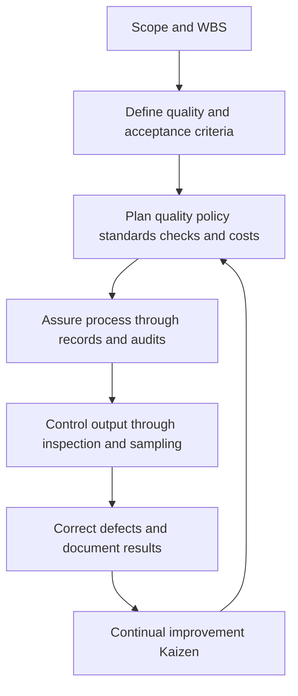

# PF1101A — Chapter 9: Project Quality Management

> [!summary] Chapter overview
> Project Quality Management defines **what good quality means**, plans how it will be achieved, assures that the agreed processes are followed, and controls whether actual outputs conform. Quality must be specified in **measurable acceptance criteria**, built into scope, schedule and cost, and improved through evidence and feedback rather than relying only on final inspection.

## Lecture Framework — Define, Plan, Assure, Control

| Part | Central question | Connection to IPEMC |
|---|---|---|
| **A. Define** | What does quality mean? | Initiating and Planning |
| **B. Plan** | How will we achieve it? | Planning |
| **C. Assure** | Are we following the process? | Executing |
| **D. Control** | Does the output conform? | Monitoring & Controlling through Closing |

![[Attachments/Quality Framework IPEMC.png]]

> [!important] Relationship to scope and cost
> Scope and the **WBS** are the “mothership”: quality criteria must relate to defined deliverables. Prevention, tests, inspections and possible rework use resources and must be included in project scope, schedule and cost estimates. The project manager integrates these decisions across the nine knowledge areas.

## Case Study — Dyson: Quality Is Designed In

- James Dyson investigated the **root cause** of vacuum cleaners losing suction rather than treating symptoms.
- He developed **5,127 prototypes** of the dual-cyclone vacuum between 1979 and 1984; the **DC01** launched in 1993 and became a major success.
- Dyson also invested in extensive testing of products such as the Supersonic hairdryer (**about 600 prototypes**, and about **£50 million**, as presented in the slides).
- Dyson starts from **specific user problems**, tests potential solutions and uses feedback to improve later versions.
- Reviewers liked the bladeless fan but complained about noise; Dyson re-engineered later models to reduce it.

> [!example] Lesson
> Early prototypes, testing and revisions may look expensive, but they are **prevention and appraisal** costs that can avoid failures after launch. The question is not simply whether testing costs money, but whether its benefits outweigh its costs.

---

## Part A — Define Quality

### What Is Quality?

The lecture cites ISO 8402:1994:

> “The totality of characteristics of an entity that bear on its ability to satisfy stated or implied needs.”

ISO 9000:2015 expresses quality as **the degree to which inherent characteristics fulfil requirements**.

- The entity can be a product, service, meal, flight or renovated home.
- Quality is partly subjective because people have different expectations and experiences.
- Customers often express vague wishes; the project team must communicate with them and translate wishes into **testable requirements**.
- Quality extends beyond the product: for a renovation it includes **product** (aligned tiles, no leaks), **service** (responsive contractor) and **time** (completion when needed).

### Quality versus Grade

| Quality | Grade |
|---|---|
| **Meeting stated requirements and expectations** | Category of products with the same function but different technical characteristics |
| Low quality is **always a problem** | Low grade **may be an acceptable choice** |
| Relevant at any price point | Involves feature–price trade-offs |
| Example: an unreliable budget car has low quality | Example: economy class versus business class |

![[Attachments/Quality Versus Grade.png]]

**Dyson Contrarotator washing machine:** The machine worked as designed, but its approximately **£1,000** price was around twice that of a competitor. It was withdrawn by 2005. The lecturer presents this as a **grade/pricing decision**, not necessarily a quality defect.

### Customer Satisfaction: Two Tests

1. **Conformance to requirements:** Did we build what we agreed to build? Compare with specifications, drawings and contracts.
2. **Fitness for purpose:** Does it actually work for the user in real conditions?

![[Attachments/Conformance and Fitness.png]]

- **Conforms but not fit:** bathroom tiles satisfy the specified design but become slippery when wet; or a carpet is installed exactly as ordered in an unsuitable kitchen.
- **Fit but does not conform:** a contractor unilaterally improves a design without approval. It may work, but it does not match the agreed specification.

> [!warning]
> Conformance alone does not guarantee customer satisfaction. A product must also be fit for the user's purpose. Conversely, an unapproved improvement can still fail conformance.

---

## Part B — Plan Quality

### ISO 9000 and ISO 9001

- **ISO**: International Organization for Standardization, based in Geneva.
- **ISO 9000**: principles and vocabulary for quality management.
- **ISO 9001**: requirements that a quality management system must meet.
- Organisations write their own procedures to fit the standard; an external certification body can audit them.
- Singapore adopts relevant standards, such as **SS ISO 9001**.
- The standard supplies a common benchmark, not a ready-made set of procedures identical for every company.

### Plan–Do–Check–Act (PDCA)

| Stage | ISO 9001 emphasis |
|---|---|
| **Plan** | Objectives, risks and how requirements will be met (Clause 6) |
| **Do** | Support, people, resources and operations (Clauses 7–8) |
| **Check** | Performance evaluation, monitoring, measurement and audits (Clause 9) |
| **Act** | Corrective action and continual improvement (Clause 10) |

Customer requirements and interested parties are inputs; **leadership/top-management commitment** (Clause 5) drives the cycle.

![[Attachments/ISO PDCA Cycle.png]]

### Four Principles of a Quality Approach

1. **Prevention over correction:** preventing a defect is generally cheaper than finding and repairing it later.
2. **Management responsibility:** quality requires committed senior management, people and resources.
3. **Kaizen (continuous improvement):** make small improvements continually.
4. **Marginal improvement:** keep improving while the additional benefit exceeds the additional cost; stop when further improvement costs more than it earns (**gold plating**).

![[Attachments/Quality Principles Marginal Improvement.png]]

### Preparing for Quality

1. **Choose a quality policy:** e.g. ISO 9000, Six Sigma or Total Quality Management (TQM).
2. **Start from scope and WBS:** identify work packages requiring quality attention.
3. **Identify applicable standards:** industry rules, regulations and relevant agencies (e.g. BCA, IMDA).
4. **Plan checks and reviews:** what, when and by whom.
5. **Document and apply PDCA:** records support audits, improvements and dispute resolution.

> [!important]
> **Quality is planned in, not inspected in.** Testing and prototyping must be budgeted and scheduled before delivery, not treated as an afterthought.

### Cost of Quality (COQ)

| Classification | Type | Examples |
|---|---|---|
| **Cost of conformance** — getting it right | **Prevention** | Training, proper tools, supervision, design reviews, prototypes, quality planning |
| **Cost of conformance** | **Appraisal** | Inspection, tests, audits, calibration |
| **Cost of nonconformance** — things going wrong | **Internal failure** | Scrap, rework, defect repair, delays discovered before handover |
| **Cost of nonconformance** | **External failure** | Warranty claims, recalls, complaints, lost customers, reputational damage |

![[Attachments/Cost of Quality.png]]

**Cost-management connection:** Rework already incurred remains in **Actual Cost (AC)**. When forecasting future costs, assess whether the underlying problem will recur; do not automatically extrapolate a one-off problem.

### Benefit–Cost Analysis and Gold Plating

- Aim for the **needed level of quality**: what customers expect, regulations require and the project can sustain.
- Compare the benefits of quality efforts with their costs.
- Improvement is justified while added benefits exceed added costs.
- **Gold plating** means adding features or quality beyond what was requested and what customers are willing to pay for.

### Benchmarking and Quality Measures

- **Benchmarking:** compare with other projects, firms or accepted standards.
- **KPIs:** defect counts, quality scores, turnaround times and similar measurable indicators.
- **Design of experiments:** vary design parameters to identify effective solutions at acceptable cost; Dyson's iterative design is an example.
- **CONQUAS**: BCA's Construction Quality Assessment System, established in 1989; assessors sample construction finishes and functional performance such as water leakage.
- Since 2023, the lecture describes **six quality bands** based on a six-year track record. Homebuyers can check the project, developer and builder bands.

![[Attachments/CONQUAS Benchmark.png]]

> [!warning]
> CONQUAS uses **sampling**. A good band does not guarantee every individual unit is free of defects.

### Creating the Quality Management (QM) Plan

The plan sets out three related levels:

| Level | Key question | Focus |
|---|---|---|
| **1. Quality control (QC)** | Does it conform? | Inspect/test output; pass or fail |
| **2. Quality assurance (QA)** | Did we follow the process? | Document and audit procedures and evidence |
| **3. Quality improvement (Kaizen)** | Are we getting better? | Evaluate results and improve the process |

![[Attachments/QM Plan Three Levels.png]]

**Key distinction:** A process can be followed perfectly and still be a poor process. Therefore QA alone is insufficient; quality improvement must use the measured results of QC and the records from QA.

### Operational Definitions: Making “Good” Measurable

A useful operational definition specifies:

| Component | Question |
|---|---|
| **Metric** | What is measured? |
| **Method** | How is it measured? |
| **Target** | What counts as conforming? |
| **Sign-off** | Who accepts it? |

![[Attachments/Operational Definitions.png]]

**Lecture examples:**
- “Good customer service” → **95%** of service calls answered by a live person within **30 seconds**, measured weekly from call logs.
- “Comfortable fan” → measurable airflow amplification and smoothness, using an identified measurement method.
- “No leaks” → a **24-hour ponding test** before tiling, witnessed and signed by contractor and owner (duration depends on specification).

### Practical Quality Control Plan

Specify **what** to check (product, workmanship, service, safety, time); **how** (test, inspection, checklist, review, walkthrough); **who** (project manager, contractor, specialist, user representative); **when** (during work, before delivery/acceptance, after repairs); and **evidence** (signed checklist, test result, photograph, defect log or approval).

> [!tip] GRPP application
> Avoid statements such as “we will ensure high quality.” Define a measurable target, a method of verification, an accountable party, the inspection time and the record used for acceptance.

---

## Part C — Assure Quality

### Quality Audits

**Quality assurance** checks whether the agreed quality processes are actually being followed.

- **Purpose:** formally review what worked, what did not and how performance can improve—not merely find fault.
- **Timing:** regular scheduled audits or unannounced audits.
- **Internal audits:** colleagues or staff review internal procedures.
- **External audits:** regulators or independent certification bodies review the system.
- **Evidence:** procedures, records, test reports and proof of actual implementation.
- **Certification:** ISO 9001 certification requires surveillance audits and periodic renewal (the lecture states every three years).

> [!important]
> **Say what you do, do what you say, and record that you have done it.** Without records, compliance cannot be demonstrated reliably.

### Fastenal: A Real Quality Management System

The lecture examines **Fastenal's January 2025 Quality Policy Manual**, a seven-page manual from an ISO 9001:2015-certified distributor/manufacturer.

- **Policy and leadership:** continuous improvement and customer needs, with senior-management involvement.
- **Operational definitions:** quality and supplier scorecards, returns, and satisfaction scores on a seven-point scale.
- **Quality control:** tests, calibration, internal/supplier audits, containment or quarantine of nonconforming products and recalls where needed.
- **Improvement:** root-cause methods including **8D** and **5-why**, time-bound containment and corrective action, and employee suggestions.
- **Document control:** revision history and warnings that printed copies are uncontrolled.
- **Scope of certification:** Fastenal excludes ISO 9001 Clause 8.3 (design), as it does not own its product designs.

![[Attachments/Fastenal Quality System.png]]

---

## Part D — Control Quality

### Quality Control and Inspection

QC inspects and tests outputs to detect errors and establish conformance. For mass production, inspecting every item may be impractical, so **statistical sampling** is used.

- **Attribute sampling:** check an item's properties, such as a brick's length and width (as described in the lecture).
- **Variable sampling:** examine consistency across batches.
- **Random causes:** ordinary variation expected in a process.
- **Assignable causes:** variation with an identifiable cause that needs investigation and correction.
- **Tolerance range:** acceptable product quality according to client/industry requirements.
- **Control limits:** statistical boundaries used to determine whether the process remains in control.

> [!warning]
> **Tolerance range ≠ control limits.** One refers to acceptable output; the other indicates whether a process is behaving within statistical control.

### Inspection and Acceptance

- **Reviews:** examine designs, calculations or work.
- **Product reviews:** test the output (e.g. beta app interface and usability).
- **Walk-throughs:** physically inspect a completed facility or deliverable.
- **Audits:** formally examine procedures and records.

The lecturer connects inspections to **client certification and payment**: work is typically inspected and certified before a contractor or vendor is paid.

### Cause-and-Effect (Ishikawa / Fishbone) Diagram

Identify possible **root causes** before deciding on corrections. The lecture's bathroom-floor-leak example groups causes into:

- **Method:** tiles laid before waterproofing cured.
- **Material:** incorrect or damaged membrane.
- **Manpower:** installer not trained.
- **Measurement:** no ponding test before tiling.

![[Attachments/Fishbone Root Causes.png]]

**Procedure:** define the effect → list plausible causes by category → test possible causes rather than guessing → correct the confirmed cause.

### Process Flowcharts

A flowchart documents the sequence of work, decisions and feedback loops. It makes instructions consistent between employees and creates an auditable process. The lecture illustrates a print job from order to shipment, including a customer-approval loop.

![[Attachments/Process Flowchart.png]]

### Control Charts / Statistical Process Control (SPC)

- Horizontal axis represents **time**; the centre line represents the **mean**.
- Upper and lower **control limits** are set at a number of standard deviations ($\sigma$) from the mean.
- A point beyond a control limit suggests the process is **out of control**; investigate the assignable cause.
- **Rule of seven:** seven consecutive points on one side of the mean indicate a pattern requiring investigation.
- Particularly useful for repetitive processes such as bolts, tyres, components and concrete cubes.

![[Attachments/Control Chart.png]]

### Sigma and Quality Levels

| Range around mean | Percentage of results inside |
|---|---:|
| $\pm1\sigma$ | 68.27% |
| $\pm2\sigma$ | 95.45% |
| $\pm3\sigma$ | 99.73% |
| $\pm6\sigma$ | 99.9999998% |

The lecture states that **Six Sigma** programmes target **3.4 defects per million opportunities (DPMO)**, allowing for long-term process drift. The economically appropriate quality target depends on consequences of failure: minor biscuit-size variation differs from safety-critical surgery, aviation or structural work.

![[Attachments/Sigma Quality Levels.png]]

### Pareto Diagrams

- Sort defect categories from **largest to smallest**.
- Plot their frequency and a **cumulative line**.
- Use the approximate **80/20 rule**: a small share of causes can account for a large share of problems.
- Prioritise the major contributors instead of addressing every minor issue equally.

![[Attachments/Pareto Diagram.png]]

### Statistical Sampling and Trend Analysis

| Tool | Role |
|---|---|
| **Statistical sampling** | Examine a properly sized subset instead of testing every unit; infer batch quality while reducing inspection cost. |
| **Trend analysis** | Use historical quality records to assess whether performance may improve, hold steady or deteriorate. |

Trend-analysis methods named in the lecture include **regression, correlation and time series**.

![[Attachments/Sampling and Trend Analysis.png]]

### Results of Quality Control: Close the Loop

1. **Inspect and test** against operational definitions.
2. **Decide** whether to accept, reject or accept after repair.
3. **Record** test results, completed checklists and acceptance evidence.
4. **Correct** defects, take corrective/preventive actions and raise change requests where necessary.
5. **Improve** processes using the results and lessons learned (Kaizen).

> [!important]
> The objective is to **get it right the first time**, reducing avoidable rework. Quality control is not the end of the process: results must feed back into improvement.

---

## Chapter 9 — Key Connections

- **Scope:** acceptance criteria specify how deliverables will be judged.
- **Time:** quality checks, testing and repairs require scheduled activities.
- **Cost:** prevention/appraisal and internal/external failure costs must be estimated.
- **Integration:** quality-related changes must be assessed with the other project plans.
- **Closing:** inspections, records and sign-offs support acceptance and payments.

## Exam / Revision Checklist

- [ ] Define quality using stated/implied needs and explain why requirements must be measurable.
- [ ] Distinguish **quality versus grade** and **conformance versus fitness for purpose**.
- [ ] Explain Dyson's prototyping and feedback as prevention and improvement.
- [ ] Distinguish ISO 9000 and ISO 9001; describe **PDCA**.
- [ ] Explain prevention, management responsibility, Kaizen and marginal improvement.
- [ ] Classify costs into prevention, appraisal, internal failure and external failure.
- [ ] Explain benchmarking, CONQUAS and the limits of sampling.
- [ ] Distinguish **QC, QA and quality improvement**.
- [ ] Write an operational definition using metric, method, target and sign-off.
- [ ] Explain audit purpose, evidence and internal/external audits.
- [ ] Distinguish random and assignable causes; tolerance ranges and control limits.
- [ ] Explain fishbone diagrams, process flowcharts, control charts and the rule of seven.
- [ ] Interpret sigma levels and Six Sigma's stated DPMO target.
- [ ] Explain Pareto diagrams, statistical sampling and trend analysis.
- [ ] Describe the QC feedback loop and how quality connects to scope, time, cost and closing.

> [!summary] Core ideas
> **Define** quality in terms of testable requirements and real user needs. **Plan** standards, responsibilities, measurements and cost. **Assure** that the documented processes are followed. **Control** the outputs through inspection, data and root-cause analysis. Use the findings for **continual improvement**.
