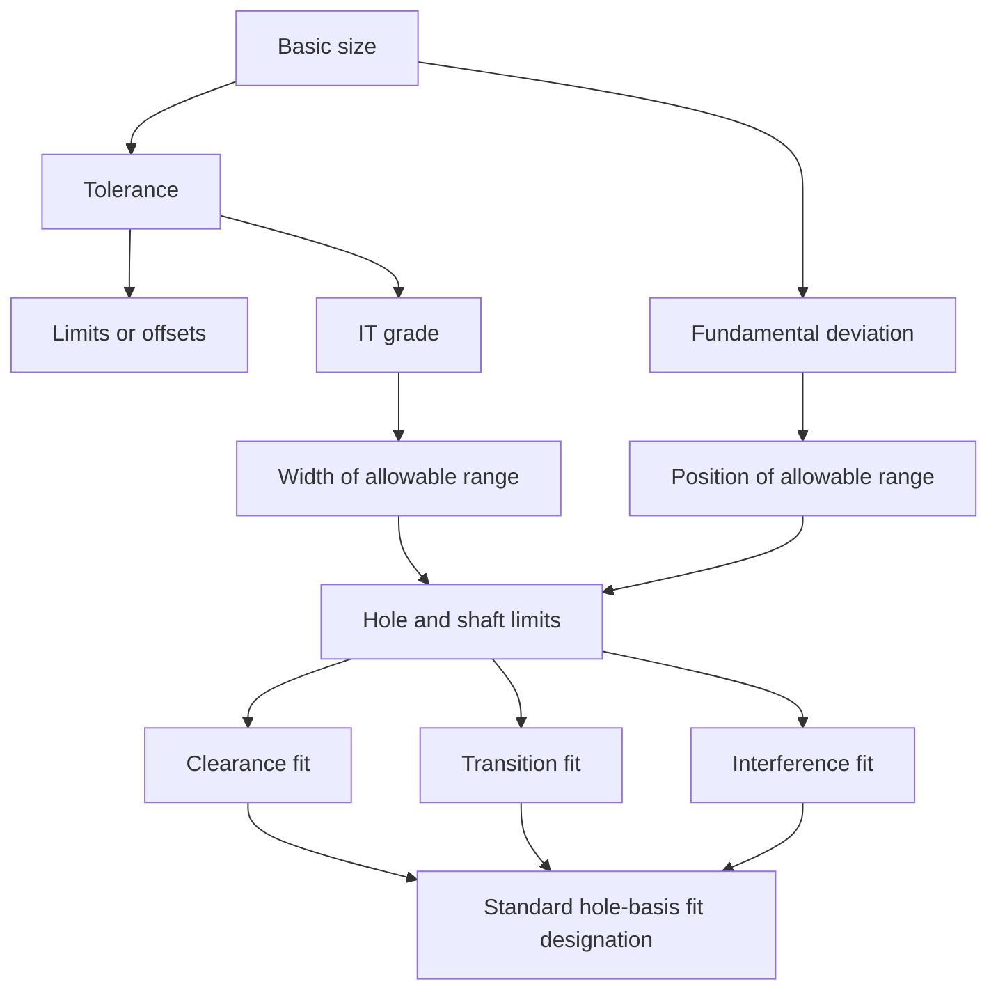

# ME2102 — Chapter 5: Limit Tolerance and Hole/Shaft Tolerance

> [!summary] Chapter overview
> Lecture 5 develops **limit tolerance** and applies it to standardized **hole/shaft fits**. It explains why manufactured dimensions require allowable variation, how limits and offsets communicate that variation, how unilateral and bilateral tolerances work, how tolerance can accumulate through chained dimensions, and how ISO tolerance classes and International Tolerance (IT) grades are read. The second part introduces **fundamental deviation**, **hole basis**, and the standard **clearance, transition, and interference fits**, then uses the tolerance chart to calculate allowable hole and shaft diameters.

---

## 5.0 Fastener Representation — Lecture Carry-over

The lecture begins by completing the previous discussion on threaded fasteners before introducing tolerance.

### Cosmetic thread representation

Engineering drawings normally use a **cosmetic representation** rather than modelling the complete helical thread geometry.

- Threaded regions are represented using the **major diameter** and **minor diameter**.
- **Thread runout** is the transition region between the fully threaded and unthreaded portions.
- For an **external thread**, the end view has a break in the minor-diameter circle.
- For an **internal thread**, the break appears in the major-diameter circle.
- In a section view of an internally threaded component, the hatching extends into the threaded region because material exists there for part of the thread profile.
- A minimum full-thread depth can be specified while allowing the thread and runout to extend farther.

> [!warning]
> The lecturer highlighted a common mistake: the **major diameter is the outermost diameter of the thread**. The minor diameter must be smaller than the major diameter.

### Thread designation reminders

For the thread designation discussed in the lecture:

- `M` means **metric thread**.
- The first number gives the **major diameter**.
- The next number gives the **pitch length**, the distance between adjacent teeth.
- The final number/letter pair is a **tolerance designation**.
- A capital letter corresponds to an **internal thread / hole**.
- A lowercase letter corresponds to an **external thread / shaft**.

---

## 5.1 Tolerance

> [!definition]
> **Tolerance** is the permissible deviation from a specified dimension.

Tolerance is required because:

- mass-produced parts naturally have variability;
- manufacturing processes cannot produce arbitrary precision;
- environmental conditions can affect manufactured dimensions;
- tolerance communicates which dimensions require greater priority and precision;
- parts made separately must still fit together correctly.

### Precision and cost

Tighter tolerance generally requires more expensive manufacturing and measurement. The lecturer emphasized that trying to approach zero variation causes cost to rise sharply, because the manufacturer must both **achieve** the precision and **verify** it.

![[Attachments/Tolerance Cost Relationship.png]]

> [!tip]
> Use **looser tolerance when the application allows it**. Tight tolerance should be reserved for dimensions where it is functionally necessary.

### Component size and achievable accuracy

The lecture compares different accuracy scales and explains that allowable deviation generally increases as component size increases. General tolerances can be much wider than accurate positional tolerances or accurate fits.

Different manufacturing processes also naturally achieve different ranges of precision. Sand casting is comparatively coarse, extrusion can be affected by thermal distortion, machining can reach substantially tighter tolerances, and grinding or other post-processing can reach still finer accuracy.

![[Attachments/Manufacturing Process Accuracy.png]]

---

## 5.2 Linear / Limit Tolerance

A dimension can be specified using either **limits** or **offsets**.

### Limits

A limit specification gives the minimum and maximum allowable values directly.

For example, a dimension may be shown using:

- lower limit: $40.8$ mm
- upper limit: $41.2$ mm

The disadvantage is that the intended **basic size** is not explicitly communicated.

### Offsets from a basic size

The lecture therefore generally uses an **offset specification**. This communicates:

1. the **basic size** intended by the designer;
2. the allowable upper deviation;
3. the allowable lower deviation.

For example,

$$
41 \pm 0.2
$$

has the limits

$$
40.8 \text{ mm to } 41.2 \text{ mm}.
$$

> [!important]
> Limits tell you the allowable range, but an offset specification also preserves the designer's intended **basic size**.

---

## 5.3 Unilateral Tolerance

> [!definition]
> A **unilateral tolerance** permits variation in only one direction from the specified basic size.

For example,

$$
60^{+0.05}_{-0}
$$

permits the dimension to range from

$$
60.00 \text{ mm to } 60.05 \text{ mm}.
$$

Other examples shown in the lecture include:

$$
57.15^{+0.00}_{-0.13} = 57.02 \text{ mm to } 57.15 \text{ mm}
$$

and

$$
16.51^{+0.08}_{-0.00} = 16.51 \text{ mm to } 16.59 \text{ mm}.
$$

![[Attachments/Unilateral Tolerance.png]]

The lecturer emphasized that a pair of limits alone does **not** prove that a tolerance is unilateral because the basic size is not known. The offset form makes this explicit.

---

## 5.4 Bilateral Tolerance

> [!definition]
> A **bilateral tolerance** permits variation in both directions from the basic size.

The deviation can be either symmetric or asymmetric.

### Symmetric bilateral tolerance

$$
57.2 \pm 1.5
$$

gives

$$
55.7 \text{ mm to } 58.7 \text{ mm}.
$$

### Asymmetric bilateral tolerance

$$
57.2^{+0.8}_{-1.5}
$$

gives

$$
55.7 \text{ mm to } 58.0 \text{ mm}.
$$

![[Attachments/Bilateral Tolerance.png]]

---

## 5.5 Cumulative Tolerance

When several toleranced dimensions are chained together, their possible deviations can **accumulate**.

The lecture compares chained dimensions with **ordinate dimensioning**. When individual dimensions are specified sequentially, the overall dimension can vary by the combined deviations of those dimensions. Adding an overall tolerance can therefore provide additional information even when the dimensions initially appear redundant.

![[Attachments/Cumulative and Ordinate Dimensioning.png]]

> [!tip]
> The lecturer recommends defaulting to **ordinate / datum dimensioning from a particular origin when possible** to avoid ambiguity from tolerance building up through dimension chains.

---

## 5.6 ISO 2768 Tolerance Classes

The lecture introduces an ISO 2768 table that assigns symmetric bilateral tolerances according to:

- the **basic dimension range**; and
- the tolerance class: **Fine (f), Medium (m), Coarse (c), Very coarse (v)**.

![[Attachments/ISO 2768 Tolerance Classes.png]]

### Reading the basic-dimension range

The table uses **Above** and **Up to** columns.

- **Above** is exclusive.
- **Up to** is inclusive.

Therefore, a dimension exactly on a boundary belongs to the row ending at that value.

> [!warning]
> For a basic size of $400$ mm, use the row that goes **up to 400 mm**, not the row that begins **above 400 mm**.

### Worked practice — Coarse 50

For a basic size of $50$ mm with **Coarse** tolerance:

- $50$ mm lies in the range above $30$ mm and up to $120$ mm.
- Coarse tolerance is $\pm 0.8$ mm.

Therefore the minimum allowable length is

$$
50 - 0.8 = 49.2 \text{ mm}.
$$

### Worked practice — Fine 400

For a basic size of $400$ mm with **Fine** tolerance:

- $400$ mm belongs to the range above $120$ mm and up to $400$ mm.
- Fine tolerance is $\pm 0.2$ mm.

Therefore the maximum allowable length is

$$
400 + 0.2 = 400.2 \text{ mm}.
$$

---

## 5.7 International Tolerance (IT) Grade

> [!definition]
> The **International Tolerance (IT) grade** specifies the **width of the allowable range of dimensions**.

The lecture uses IT grades 5 through 11 in the tolerance chart. As the IT grade number increases, the allowable tolerance width increases.

> [!important]
> An IT grade specifies the **difference between the maximum and minimum allowable dimensions**. By itself, it does **not** specify where that range lies relative to the basic size.

Different manufacturing processes have characteristic IT-grade ranges.

![[Attachments/Manufacturing Processes and IT Grades.png]]

For the practice question in the lecture, **milling** cannot naturally achieve an IT grade of 7 according to the provided chart.

---

# 5.8 Hole / Shaft Tolerance

Hole/shaft fits use standardized number-and-letter designations so that a desired fit can be communicated without writing several high-precision limit dimensions on the drawing.

For example, the slide shows

$$
\varnothing 25g6 = \varnothing 24.980 - \varnothing 24.993.
$$

A standardized fit can similarly be communicated as a **sliding fit** at a chosen basic size rather than manually specifying four separate limits for the hole and shaft.

---

## 5.9 IT Grade and Fundamental Deviation

A hole/shaft tolerance designation combines two pieces of information:

- the **number** gives the IT grade, which determines the width of the allowable range;
- the **letter** gives the **fundamental deviation**, which determines where that range lies relative to the basic size.

![[Attachments/Hole Shaft Tolerance Illustration.png]]

### Upper and lower deviation

For both a hole and a shaft, the allowable range has:

- a **minimum size**;
- a **maximum size**;
- an **upper deviation** from the basic size;
- a **lower deviation** from the basic size.

### Fundamental deviation

> [!definition]
> The **fundamental deviation** is the deviation on the side of the allowable range **closest to the basic size**.

Therefore:

- if the allowable range is **below** the basic size, the fundamental deviation is the **upper deviation**;
- if the allowable range is **above** the basic size, the fundamental deviation is the **lower deviation**.

The lecture does not consider tolerance ranges crossing over the basic size.

![[Attachments/Fundamental Deviation Chart and Diagram.png]]

> [!important]
> `h` / `H` corresponds to a fundamental deviation of **zero**. For a shaft, the `h` tolerance range lies below the basic size; for a hole, the `H` tolerance range lies above the basic size.

---

## 5.10 Hole Basis

The convention used in the course is **hole basis**.

> [!definition]
> In **hole basis**, the hole always uses fundamental deviation **H**, so its minimum diameter equals the basic size and its allowable range extends upward by the hole's IT grade.

Thus, for a hole in hole basis:

$$
\text{Minimum hole size} = \text{Basic size}
$$

and

$$
\text{Maximum hole size} = \text{Basic size} + \text{IT grade}.
$$

The lecturer explains that a drilled hole naturally cannot be smaller than the cutting tool diameter, while inaccuracies can make the hole slightly larger. It is also generally easier to modify a shaft diameter than to make a hole diameter highly precise.

![[Attachments/Hole Basis Fits Diagram.png]]

### Shaft basis

The lecture briefly contrasts this with **shaft basis**, where the shaft is fixed and the hole size is varied. The course does not use shaft basis for the calculations in this lecture.

---

## 5.11 Standard Fits

The three standard fit categories are:

1. **Clearance fit**
2. **Transition fit**
3. **Interference fit**

![[Attachments/Standard Fits Diagram.png]]

### Clearance fit

The shaft is always smaller than the hole.

The lecture associates clearance fits with situations where relative motion, insertion/removal, rotation, or some misalignment must be allowed.

For a clearance fit:

$$
\text{Maximum clearance} = \text{Maximum hole} - \text{Minimum shaft}
$$

$$
\text{Minimum clearance} = \text{Minimum hole} - \text{Maximum shaft}.
$$

### Interference fit

The shaft is always larger than the hole.

$$
\text{Maximum interference} = \text{Maximum shaft} - \text{Minimum hole}
$$

$$
\text{Minimum interference} = \text{Minimum shaft} - \text{Maximum hole}.
$$

### Transition fit

A transition fit can result in either clearance or interference depending on the actual manufactured dimensions within their permitted ranges.

For a transition fit, the lecture discusses:

- **maximum clearance**; and
- **maximum interference**.

> [!important]
> The lecturer avoids describing these situations using negative clearance or negative interference. Use the positive quantity of the appropriate convention instead.

---

## 5.12 Hole Basis Fit Table

The provided chart combines the IT-grade and fundamental-deviation information required for the course.

![[Attachments/Hole Basis Tolerance Table.png]]

The hole-basis fit chart maps qualitative fit names to hole and shaft tolerance designations.

![[Attachments/Hole Basis Fits Chart.png]]

| Fit category | Fit | Hole | Shaft |
|---|---|---|---|
| Clearance — Running | Loose | H11 | c11 |
| Clearance — Running | Free | H9 | d9 |
| Clearance — Running | Close | H8 | f7 |
| Clearance — Precision | Sliding | H7 | g6 |
| Clearance — Precision | Location | H7 | h6 |
| Transition | Light | H7 | k6 |
| Transition | Heavy | H7 | n6 |
| Interference | Location | H7 | p6 |
| Interference | Drive | H7 | s6 |
| Interference | Force | H7 | u6 |

---

## 5.13 Procedure for Finding Hole and Shaft Limits

When a fit type and basic diameter are given:

1. **Identify the fit** in the hole-basis fit chart.
2. Read the corresponding **hole designation** and **shaft designation**.
3. Locate the correct **basic-size row** in the tolerance chart.
4. For the hole, read the **IT grade**. In hole basis, fundamental deviation $H=0$.
5. Calculate the hole limits:
   - minimum hole = basic size;
   - maximum hole = basic size + hole IT grade.
6. For the shaft, read its **fundamental deviation** and **IT grade**.
7. Determine whether the shaft range lies above or below the basic size.
8. Calculate the minimum and maximum shaft sizes using the fundamental deviation and IT-grade width.
9. Check that the difference between the shaft's maximum and minimum dimensions equals the shaft IT grade.
10. Check that the side of the tolerance range closest to the basic size is separated from it by the fundamental deviation.

> [!tip]
> The lecturer's checking method is useful: **maximum size − minimum size must equal the IT grade**, and the distance from the basic size to the nearest end of the tolerance range must equal the **fundamental deviation**.

---

## 5.14 Worked Example — $\varnothing 90$ Sliding Fit

A **sliding fit** corresponds to:

- hole: **H7**
- shaft: **g6**

The $90$ mm basic size lies in the $80$–$100$ mm row of the chart.

### Hole — H7

From the chart:

- FD $H = 0.000$ mm
- IT 7 $= 0.035$ mm

Therefore:

$$
\text{Minimum hole} = 90.000 \text{ mm}
$$

$$
\text{Maximum hole} = 90.035 \text{ mm}.
$$

![[Attachments/Sliding Fit 90mm Hole Example.png]]

### Shaft — g6

From the chart:

- FD $g = -0.012$ mm
- IT 6 $= 0.022$ mm

The range lies below the basic size, so the maximum shaft is the end closest to the basic size:

$$
\text{Maximum shaft} = 90.000 - 0.012 = 89.988 \text{ mm}
$$

and

$$
\text{Minimum shaft} = 89.988 - 0.022 = 89.966 \text{ mm}.
$$

![[Attachments/Sliding Fit 90mm Shaft Example.png]]

---

## 5.15 Worked Example — $\varnothing 25$ Sliding Fit

Again, sliding fit uses **H7/g6**.

The $25$ mm basic size lies in the row above $24$ mm and up to $30$ mm.

### Hole — H7

- FD $H = 0.000$ mm
- IT 7 $= 0.021$ mm

Therefore:

$$
\text{Minimum hole} = 25.000 \text{ mm}
$$

$$
\text{Maximum hole} = 25.021 \text{ mm}.
$$

![[Attachments/Sliding Fit 25mm Hole Example.png]]

### Shaft — g6

- FD $g = -0.007$ mm
- IT 6 $= 0.013$ mm

Therefore:

$$
\text{Maximum shaft} = 25.000 - 0.007 = 24.993 \text{ mm}
$$

$$
\text{Minimum shaft} = 24.993 - 0.013 = 24.980 \text{ mm}.
$$

![[Attachments/Sliding Fit 25mm Shaft Example.png]]

---

## 5.16 Additional Lecture Examples

### $\varnothing 12$ Free Fit

A **free fit** corresponds to **H9/d9**.

For the hole, the minimum diameter is the basic size and the maximum diameter is obtained by adding the H9 IT grade. For the shaft, the `d` fundamental deviation places the allowable shaft range below the basic size.

### Maximum diameter of a $35$ mm hole — Loose Fit

A **loose fit** uses **H11/c11**. Only the hole is required in this question.

For $35$ mm:

- H fundamental deviation = $0$;
- IT 11 = $160$ microns.

Therefore:

$$
\text{Maximum hole} = 35.000 + 0.160 = 35.160 \text{ mm}.
$$

### Minimum diameter of a $75$ mm shaft — Heavy Fit

A **heavy transition fit** uses shaft designation **n6**.

Because `n` lies beyond `h`, the shaft's tolerance range is **above** the basic size. The minimum shaft size is therefore the end closest to the basic size, so only the fundamental deviation is added.

For this example, the fundamental deviation is $20$ microns:

$$
\text{Minimum shaft} = 75.000 + 0.020 = 75.020 \text{ mm}.
$$

> [!warning]
> For a shaft range **above** the basic size, the fundamental deviation gives the **minimum** shaft size. The IT grade is added to reach the maximum. This is the reverse of the below-basic-size case used for `g6`.

### $200s9$ shaft

The lowercase letter identifies this as a **shaft** tolerance. Since `s` is beyond `h`, its tolerance range lies above the basic size.

For the maximum diameter, the lecture uses:

- FD $s = 0.122$ mm
- IT 9 $= 0.115$ mm

so

$$
\text{Maximum shaft} = 200.000 + 0.122 + 0.115 = 200.237 \text{ mm}.
$$

### Maximum interference — $20$ mm Force Fit

A **force fit** uses **H7/u6**.

Maximum interference is

$$
\text{Maximum shaft} - \text{Minimum hole}.
$$

In hole basis, the minimum hole equals the basic size. Therefore only the shaft's deviation above the basic size remains.

For the $20$ mm force-fit example:

- FD $u = 41$ microns
- IT 6 $= 13$ microns

Hence

$$
\text{Maximum interference} = 41 + 13 = 54 \text{ microns}.
$$

---

# Chapter 5 — Key Connections

## Exam / Revision Checklist

- [ ] Can I explain why manufactured parts require tolerance?
- [ ] Can I distinguish **limits** from **offset tolerances**?
- [ ] Can I identify and calculate **unilateral** and **bilateral** tolerance limits?
- [ ] Do I understand why chained dimensions can produce **cumulative tolerance**?
- [ ] Can I correctly read **Above** and **Up to** boundaries in the ISO tolerance table?
- [ ] Can I use an ISO 2768 tolerance class to calculate minimum or maximum dimensions?
- [ ] Do I know that the **IT grade is the width of the allowable range**?
- [ ] Can I use the manufacturing-process chart to identify achievable IT grades?
- [ ] Can I identify a hole from a **capital** tolerance letter and a shaft from a **lowercase** letter?
- [ ] Can I explain **fundamental deviation** as the end of the range closest to the basic size?
- [ ] Do I know that hole basis uses **H**, with minimum hole size equal to the basic size?
- [ ] Can I distinguish **clearance, transition, and interference fits**?
- [ ] Can I use the fit chart to obtain designations such as **H7/g6**?
- [ ] Can I calculate the minimum and maximum hole and shaft diameters from the tolerance chart?
- [ ] Can I calculate maximum/minimum clearance or interference using the correct hole and shaft limits?
- [ ] Can I check that the tolerance width equals the stated IT grade?

## Key Equations / Relationships

> [!summary] Core relationships
> **Symmetric bilateral tolerance**
> $$
> \text{Minimum} = \text{Basic size} - \text{Tolerance}
> $$
> $$
> \text{Maximum} = \text{Basic size} + \text{Tolerance}
> $$
>
> **Hole basis**
> $$
> \text{Minimum hole} = \text{Basic size}
> $$
> $$
> \text{Maximum hole} = \text{Basic size} + \text{IT grade}
> $$
>
> **Clearance**
> $$
> \text{Maximum clearance} = \text{Maximum hole} - \text{Minimum shaft}
> $$
> $$
> \text{Minimum clearance} = \text{Minimum hole} - \text{Maximum shaft}
> $$
>
> **Interference**
> $$
> \text{Maximum interference} = \text{Maximum shaft} - \text{Minimum hole}
> $$
> $$
> \text{Minimum interference} = \text{Minimum shaft} - \text{Maximum hole}
> $$
>
> **Tolerance-range checks**
> $$
> \text{Maximum size} - \text{Minimum size} = \text{IT grade}
> $$
>
> The **fundamental deviation** is the distance from the basic size to the nearest end of the allowable range.
